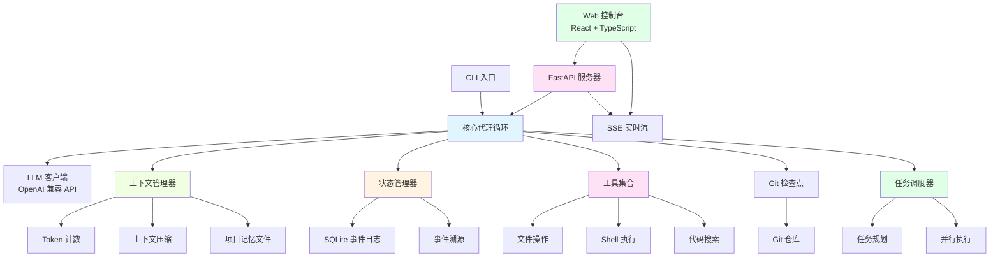
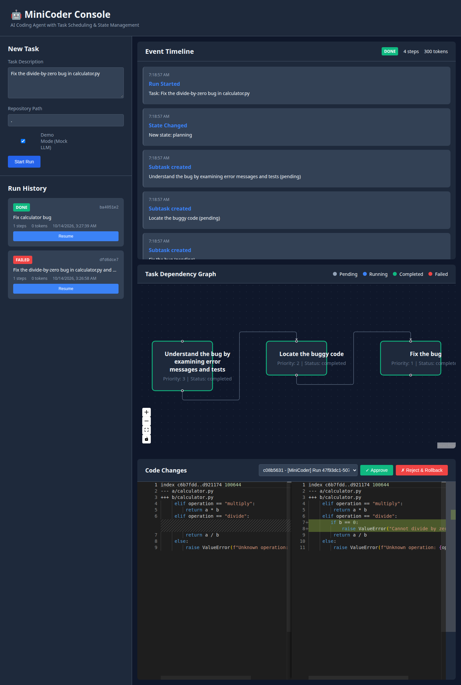

# MiniCoder

<div align="center">

**一个高质量的代码代理系统，展示完整的 Agent Runtime 设计**

[English](#english-version) | [中文](#中文版本)

[](https://github.com/username/minicoder/actions)
[](https://www.python.org/downloads/)
[](https://opensource.org/licenses/MIT)

</div>

---

## 中文版本

### 📖 概述

MiniCoder 是一个从零开始构建的编码代理（Coding Agent），展示了生产级 Agent Runtime 的核心设计模式：

- **任务调度（Task Scheduling）**：基于依赖关系的任务分解和并行执行
- **状态管理（State Management）**：事件溯源（Event Sourcing）+ SQLite 持久化
- **上下文管理（Context Management）**：Token 预算、智能压缩、大输出卸载
- **工具执行（Tool Execution）**：文件操作、代码搜索、Shell 执行（可选 Docker 沙箱）

该项目专为展示 AI Agent 工程能力而设计，不依赖任何代理框架（LangChain/LlamaIndex）。

### 🏗️ 架构设计



### 🖥️ Web 控制台




MiniCoder 提供了一个现代化的 Web 控制台，使用 **React + TypeScript** 构建：

**前端特性**：
- ✨ **实时事件流**：通过 SSE 实时显示 LLM 推理和工具调用
- 📝 **任务输入面板**：直观的任务创建界面，支持 Demo 模式
- 🔍 **Monaco 代码查看器**：并排查看代码变更，支持批准/回滚
- 📊 **运行历史**：查看所有运行记录，支持恢复和回滚
- 🌐 **子任务 DAG 可视化**：使用 React Flow 展示任务依赖关系图
- 🎨 **Markdown 渲染**：代码高亮显示 LLM 消息
- 🔄 **状态管理**：使用 Zustand 进行类型安全的状态管理
- ✅ **批准/拒绝操作**：直接从界面批准更改或回滚到检查点

**后端 API**：
- 🚀 **FastAPI**：高性能异步 API 服务器
- 📡 **SSE 流**：实时推送代理事件
- 🔧 **RESTful 端点**：启动/恢复/中止运行、查看事件、管理检查点
- 📦 **静态文件服务**：内置提供前端构建文件
- 🐳 **可选 Docker**：安全的沙箱执行环境

### 🎯 核心设计决策

#### 1. 状态管理：事件溯源 vs 快照

**选择：事件溯源（Event Sourcing）**

- ✅ **优势**：
  - 完整的审计日志，可追溯每一步决策
  - 支持时间旅行调试和从任意点恢复
  - 易于实现乐观并发控制
  
- ⚠️ **权衡**：
  - 事件重放可能较慢（已优化：只重放最近 N 条消息）
  - 存储空间增长（已缓解：大输出卸载到文件）

#### 2. 任务调度：顺序执行 vs 并行执行

**选择：带依赖的并行调度**

- ✅ **优势**：
  - 独立子任务并行执行，提高效率
  - 显式依赖图，便于调试和可视化
  - 支持优先级和重试策略
  
- ⚠️ **权衡**：
  - 增加系统复杂度
  - 需要仔细管理共享状态（文件级锁避免两个 worker 同时改同一文件；独立编辑仍可并行）

#### 3. 上下文管理：固定窗口 vs 智能压缩

**选择：混合策略**

- 保持最近 N 轮对话完整（默认 5 轮）
- 对更早的对话生成摘要
- 大型工具输出（>1000 tokens）卸载到文件，只保留引用
- 支持项目记忆文件（AGENTS.md）持久化关键信息

#### 4. 工具执行：本地 vs Docker 沙箱

**选择：本地优先，Docker 可选**

- 默认本地执行（快速开发）
- 可选 Docker 沙箱（生产安全）
- 超时和输出截断保护

### 🚀 快速开始

#### 安装

```bash
# 克隆仓库
git clone https://github.com/username/minicoder.git
cd minicoder

# 安装后端（开发模式）
pip install -e ".[dev]"

# 安装前端依赖
cd web
npm install
cd ..

# 可选：安装 Docker 支持
pip install -e ".[docker]"
```

#### 使用 Web 控制台 🌐

**启动完整系统（单命令）**：
```bash
# 构建前端
cd web && npm install && npm run build && cd ..

# 启动服务器（自动提供前端）
minicoder serve --host 0.0.0.0 --port 8000

# 在浏览器中打开 http://localhost:8000
```

**开发模式（热重载）**：
```bash
# 终端 1: 启动后端
minicoder serve --host 0.0.0.0 --port 8000

# 终端 2: 启动前端开发服务器
cd web && npm run dev
# 访问 http://localhost:5173
```

**Demo 模式**：勾选 "Demo Mode (Mock LLM)" 复选框即可无需 API key 运行完整演示。

**功能演示**：
- ✅ 在任务输入框中输入任务描述
- ✅ 实时查看事件时间线和工具调用
- ✅ 在 DAG 图中查看任务依赖关系
- ✅ 在 Monaco Editor 中查看代码变更
- ✅ 使用"Approve"或"Reject & Rollback"按钮管理更改
- ✅ 从运行历史中恢复或回滚之前的运行

#### 配置 API （CLI 和 Web 控制台）

**选项 1：使用阿里云通义千问（Qwen）DashScope**

```bash
export OPENAI_API_KEY="sk-your-dashscope-api-key"
export OPENAI_BASE_URL="https://dashscope.aliyuncs.com/compatible-mode/v1"

minicoder run "修复这个 bug" --model qwen-max
```

**选项 2：使用本地 vLLM**

```bash
# 启动 vLLM 服务器（另一个终端）
vllm serve qwen/Qwen2.5-7B-Instruct --api-key dummy

# 使用 MiniCoder
export OPENAI_API_KEY="dummy"
export OPENAI_BASE_URL="http://localhost:8000/v1"

minicoder run "实现新功能" --model qwen/Qwen2.5-7B-Instruct
```

**选项 3：使用 OpenAI**

```bash
export OPENAI_API_KEY="sk-your-openai-key"

minicoder run "重构这段代码" --model gpt-4
```

#### 使用 CLI

```bash
# 在当前目录运行任务
minicoder run "修复 calculator.py 中的除零错误"

# 指定仓库路径
minicoder run "添加输入验证" --repo /path/to/repo

# 使用 Docker 沙箱
minicoder run "运行危险脚本" --docker

# 多代理（仓库探索 + LLM JSON 计划 + 按文件划分的并发 worker）
minicoder run "修复这个 bug" --mode multi --max-parallel 3

# 禁止改测试文件
minicoder run "修复这个 bug" --protect-tests block

# 恢复中断的运行
minicoder resume <run_id>

# 查看所有运行记录
minicoder runs

# 回滚到检查点
minicoder rollback <run_id> <checkpoint_sha>

# 查看运行的检查点
minicoder checkpoints <run_id>

# 启动 Web 服务器
minicoder serve --port 8000
```

### 🧪 评估

内置 `benchmarks/toy_repos/` 目前有 13 个故意失败的玩具仓库：10 个单 bug 任务，以及 3 个 `twofix_*`（两个无关模块各有一个 bug，测试在修复前必须失败）。评测会把每个任务复制到临时目录、运行代理、**用原始测试文件打分**（代理改测试不算通过），并写出 JSON + Markdown。

针对 OpenAI 兼容接口的评测命令：

```bash
export OPENAI_API_KEY="sk-..."
export OPENAI_BASE_URL="https://api.example.com/v1"   # 任意 OpenAI 兼容 endpoint
export OPENAI_MODEL="your-model-id"

python benchmarks/evaluate.py \
  --model "$OPENAI_MODEL" \
  --base-url "$OPENAI_BASE_URL" \
  --compression default \
  --agent-mode single \
  --repeats 1 \
  --max-steps 15
```

常用开关：

- `--compression {default,off,aggressive}`：上下文压缩强度
- `--agent-mode {single,multi}`：单代理循环，或多代理（先探索仓库再让 LLM 输出带 schema 的 JSON 计划；少于 2 个独立 edit 子任务或计划无效则回退到单代理；关键词模板只作最后兜底）
- `--repeats N`：每任务重复次数（报告 mean ± stdev）
- `--protect-tests {block,flag,off}`：评测默认 `block`，禁止改测试文件
- `--request-timeout` / `--max-retries`：LLM 请求超时与退避重试（也可用 `MINICODER_REQUEST_TIMEOUT`、`MINICODER_MAX_RETRIES`）
- `--mock`：用 mock LLM 冒烟测试评测脚手架（不会真正修 bug）

结果写到 `benchmarks/results/results.json` 和 `benchmarks/results/results.md`。

```bash
python benchmarks/evaluate.py --list-tasks
```

#### 在 SWE-bench Lite 上运行

```bash
# 1. 下载 SWE-bench Lite 数据集
# https://github.com/princeton-nlp/SWE-bench

# 2. 准备数据集
mkdir -p benchmarks/swe_bench
# 将 lite_dataset.json 放入上述目录

# 3. 运行适配器
python -m benchmarks.swe_bench_adapter
```

#### 消融实验

评测 CLI 已覆盖压缩档位和 single/multi。代码里也可以直接构造：

```python
agent = CodingAgent(
    repo_path,
    state_manager,
    model=os.environ["OPENAI_MODEL"],
    max_steps=30,
    mode="multi",          # 或 "single"
    request_timeout=120,
    max_retries=2,
    protect_tests="block",
)
```

#### 指标记录

所有运行自动记录：
- 执行步数
- Token 使用量
- 工具调用次数
- 成功/失败状态
- 完整事件日志
- multi 模式下：是否 true-multi / 是否回退单代理、每个 worker 的 steps/tokens（写入 `results.json`，worker 结果不再截断到 500 字符）

查询指标：

```bash
minicoder runs --limit 100
```

### 🧑‍💻 开发

#### 后端测试

```bash
# 运行所有测试（使用 mock LLM，无需 API key）
pytest

# 带覆盖率报告
pytest --cov=minicoder --cov-report=html

# 运行特定测试
pytest tests/test_agent.py -v
```

#### 前端测试

```bash
cd web

# 运行测试
npm run test

# 类型检查
npm run typecheck

# Lint
npm run lint

# 构建
npm run build
```

#### 类型检查

```bash
mypy src/minicoder
```

#### 代码格式化

```bash
black src/minicoder tests
ruff check src/minicoder tests --fix
```

### 📊 评估结果

2026-10-14 在 DashScope 上对 PR #2 分支（`cc3079d`）做了实测，**完整表格、命令和注释见 [docs/eval-results.md](docs/eval-results.md)**（原文照录，未改数字）。

- **v2（`cc3079d` + 本地 scheduler 补丁）single**：qwen3.6-plus 三档压缩各 30/30，qwen-plus default 20/20，测试通过率 100%。**multi**：qwen3.6-plus 22/30，qwen-plus 3/20，且 **0/50 次调用 finish**。
- **v3（`425af4a`）**：死锁已消失；single 仍 10/10。**multi 回退**：qwen3.6-plus 2/30，qwen-plus 0/20，finish 1/50。原因是并行 read 子任务 3 步耗尽后失败，卡住 locate+apply。不要把 v2/v3 的 multi 数字当成后续提交的结果。
- **v4（`57491e9`）关键词 planner**：默认 `"Fix the bug..."` 提示在 10 个原任务上 **50/50 次回退到单代理**（true-multi 0/30+0/20）；三个 twofix 任务同样 9/9 回退。只有提示含 `"implement"` 时才会 true-multi（twofix 9/9 通过，但约 2× steps / 2.5× tokens，且两个 worker 是固定的「实现功能 / 加测试」模板，不是按 bug 拆分）。详见 [docs/eval-results.md](docs/eval-results.md) 的 v4 节。
- **本 PR**：用仓库感知的 LLM planner 取代关键词模板（模板仅作无效 JSON 时的最后兜底）。尚未用真实 LLM 重跑评测，不要把 v4 的 fallback 数字当成这个 planner 的结果。

### 🗺️ 路线图

- [x] 核心代理循环和工具
- [x] 事件溯源状态管理
- [x] 上下文管理和压缩
- [x] Git 检查点和回滚
- [x] 任务调度和并行执行
- [x] 单元测试和 CI
- [x] FastAPI Web 服务器（含静态文件服务）
- [x] React + TypeScript Web 控制台
- [x] SSE 实时事件流
- [x] Monaco 代码查看器（带批准/回滚）
- [x] 子任务 DAG 可视化（React Flow）
- [x] 多代理协作（仓库感知 LLM 计划 + 按文件划分的并发 worker + 文件锁 + 全量测试校验）
- [ ] 基于 tree-sitter 的代码索引
- [ ] SWE-bench Lite 完整评估

### 📄 许可证

MIT License - 详见 [LICENSE](LICENSE)

---

## English Version

### 📖 Overview

MiniCoder is a from-scratch coding agent that demonstrates production-grade Agent Runtime design patterns:

- **Task Scheduling**: Dependency-based task decomposition and parallel execution
- **State Management**: Event sourcing + SQLite persistence
- **Context Management**: Token budgeting, smart compression, large output offloading
- **Tool Execution**: File operations, code search, shell execution (optional Docker sandbox)

Built without agent frameworks (LangChain/LlamaIndex) to showcase AI Agent engineering skills.

### 🏗️ Architecture

See the Mermaid diagram in the Chinese section above for the complete system architecture including the Web layer.

### 🖥️ Web Console


MiniCoder features a modern **React + TypeScript** web console with:

**Frontend Features**:
- ✨ **Real-time Event Streaming**: Live display of LLM reasoning and tool calls via SSE
- 📝 **Task Input Panel**: Intuitive interface for creating tasks with Demo mode support
- 🔍 **Monaco Diff Viewer**: Side-by-side code changes with approve/reject actions
- 📊 **Run History**: View all runs with resume and rollback actions
- 🌐 **Subtask DAG Visualization**: React Flow dependency graph with per-node status
- 🎨 **Markdown Rendering**: Syntax-highlighted LLM messages
- 🔄 **State Management**: Type-safe state with Zustand
- ✅ **Approve/Reject Actions**: Approve changes or rollback to checkpoints directly from UI

**Backend API**:
- 🚀 **FastAPI**: High-performance async API server
- 📡 **SSE Streaming**: Real-time agent event push
- 🔧 **RESTful Endpoints**: Start/resume/abort runs, view events, manage checkpoints
- 📦 **Static File Serving**: Built-in serving of frontend build
- 🐳 **Optional Docker**: Secure sandboxed execution

### 🎯 Design Decisions

#### 1. State Management: Event Sourcing vs Snapshots

**Choice: Event Sourcing**

- ✅ **Pros**:
  - Complete audit log for every decision
  - Supports time-travel debugging and resumption
  - Easy optimistic concurrency control
  
- ⚠️ **Trade-offs**:
  - Event replay can be slow (optimized: only replay recent N messages)
  - Storage growth (mitigated: offload large outputs to files)

#### 2. Task Scheduling: Sequential vs Parallel

**Choice: Parallel with Dependencies**

- ✅ **Pros**:
  - Independent subtasks run in parallel for efficiency
  - Explicit dependency graph for debugging
  - Supports priorities and retry strategies
  
- ⚠️ **Trade-offs**:
  - Increased system complexity
  - Need careful shared state management (file-level locks so two workers cannot edit the same file at once; independent edits still run in parallel)

#### 3. Context Management: Fixed Window vs Smart Compression

**Choice: Hybrid Strategy**

- Keep last N turns verbatim (default 5)
- Summarize older conversation
- Offload large tool outputs (>1000 tokens) to files
- Support project memory file (AGENTS.md) for persistent context

#### 4. Tool Execution: Local vs Docker Sandbox

**Choice: Local-first, Docker Optional**

- Default local execution (fast development)
- Optional Docker sandbox (production safety)
- Timeout and output truncation protection

### 🚀 Quick Start

#### Installation

```bash
# Clone repository
git clone https://github.com/username/minicoder.git
cd minicoder

# Install backend (development mode)
pip install -e ".[dev]"

# Install frontend dependencies
cd web
npm install
cd ..

# Optional: Install Docker support
pip install -e ".[docker]"
```

#### Using the Web Console 🌐

**Start Complete System (One Command)**:
```bash
# Build frontend
cd web && npm install && npm run build && cd ..

# Start server (automatically serves frontend)
minicoder serve --host 0.0.0.0 --port 8000

# Open http://localhost:8000 in browser
```

**Development Mode (Hot Reload)**:
```bash
# Terminal 1: Start backend
minicoder serve --host 0.0.0.0 --port 8000

# Terminal 2: Start frontend dev server
cd web && npm run dev
# Visit http://localhost:5173
```

**Demo Mode**: Check the "Demo Mode (Mock LLM)" checkbox to run the full demo without an API key.

**Feature Demo**:
- ✅ Enter task description in the input panel
- ✅ Watch real-time event timeline and tool calls
- ✅ View task dependencies in the DAG graph
- ✅ Review code changes in Monaco Editor
- ✅ Use "Approve" or "Reject & Rollback" buttons to manage changes
- ✅ Resume or rollback previous runs from history

#### API Configuration (CLI and Web Console)

**Option 1: Alibaba Cloud Qwen DashScope**

```bash
export OPENAI_API_KEY="sk-your-dashscope-api-key"
export OPENAI_BASE_URL="https://dashscope.aliyuncs.com/compatible-mode/v1"

minicoder run "Fix this bug" --model qwen-max
```

**Option 2: Local vLLM**

```bash
# Start vLLM server (in another terminal)
vllm serve qwen/Qwen2.5-7B-Instruct --api-key dummy

# Use MiniCoder
export OPENAI_API_KEY="dummy"
export OPENAI_BASE_URL="http://localhost:8000/v1"

minicoder run "Implement new feature" --model qwen/Qwen2.5-7B-Instruct
```

**Option 3: OpenAI**

```bash
export OPENAI_API_KEY="sk-your-openai-key"

minicoder run "Refactor this code" --model gpt-4
```

#### Using the CLI

```bash
# Run task in current directory
minicoder run "Fix divide-by-zero error in calculator.py"

# Specify repository path
minicoder run "Add input validation" --repo /path/to/repo

# Use Docker sandbox
minicoder run "Run dangerous script" --docker

# Multi-agent (repo exploration + LLM JSON plan + file-scoped workers)
minicoder run "Fix this bug" --mode multi --max-parallel 3

# Block edits to test files
minicoder run "Fix this bug" --protect-tests block

# Resume interrupted run
minicoder resume <run_id>

# List all runs
minicoder runs

# Rollback to checkpoint
minicoder rollback <run_id> <checkpoint_sha>

# View checkpoints for a run
minicoder checkpoints <run_id>

# Start web server
minicoder serve --port 8000
```

### 🧪 Evaluation

`benchmarks/toy_repos/` currently has 13 intentionally failing toy repos: 10 single-bug tasks plus 3 `twofix_*` repos (two unrelated modules, one bug each; tests must fail before a fix). The harness copies each task to a fresh temp dir, runs the agent, **grades against the original tests** (rewriting tests does not count), and writes JSON + Markdown.

Against any OpenAI-compatible endpoint:

```bash
export OPENAI_API_KEY="sk-..."
export OPENAI_BASE_URL="https://api.example.com/v1"   # any OpenAI-compatible endpoint
export OPENAI_MODEL="your-model-id"

python benchmarks/evaluate.py \
  --model "$OPENAI_MODEL" \
  --base-url "$OPENAI_BASE_URL" \
  --compression default \
  --agent-mode single \
  --repeats 1 \
  --max-steps 15
```

Flags:

- `--compression {default,off,aggressive}`
- `--agent-mode {single,multi}` — single loop, or multi-agent (explore the repo, then an LLM emits a schema-validated JSON plan; fall back to single-agent when there are fewer than 2 independent edit subtasks or the plan is invalid; keyword templates are last-resort only)
- `--repeats N` — mean ± stdev across repeats
- `--protect-tests {block,flag,off}` — default `block` in eval
- `--request-timeout` / `--max-retries` (or `MINICODER_REQUEST_TIMEOUT` / `MINICODER_MAX_RETRIES`)
- `--mock` — smoke-test the harness with a mock LLM

Output: `benchmarks/results/results.json` and `benchmarks/results/results.md`.

#### Run on SWE-bench Lite

```bash
# 1. Download SWE-bench Lite dataset
# https://github.com/princeton-nlp/SWE-bench

# 2. Prepare dataset
mkdir -p benchmarks/swe_bench
# Place lite_dataset.json in the above directory

# 3. Run adapter
python -m benchmarks.swe_bench_adapter
```

#### Ablation Studies

The eval CLI covers compression presets and single/multi. You can also construct an agent directly:

```python
agent = CodingAgent(
    repo_path,
    state_manager,
    model=os.environ["OPENAI_MODEL"],
    max_steps=30,
    mode="multi",          # or "single"
    request_timeout=120,
    max_retries=2,
    protect_tests="block",
)
```

#### Metrics Collection

All runs automatically record:
- Execution steps
- Token usage
- Tool call counts
- Success/failure status
- Complete event log
- In multi mode: true-multi vs fallback-to-single, plus per-worker steps/tokens (written to `results.json`; worker results are no longer truncated to 500 characters)

Query metrics:

```bash
minicoder runs --limit 100
```

### 🧑‍💻 Development

#### Backend Tests

```bash
# Run all tests (uses mock LLM, no API key needed)
pytest

# With coverage report
pytest --cov=minicoder --cov-report=html

# Run specific test
pytest tests/test_agent.py -v
```

#### Frontend Tests

```bash
cd web

# Run tests
npm run test

# Type checking
npm run typecheck

# Lint
npm run lint

# Build
npm run build
```

#### Type Checking

```bash
mypy src/minicoder
```

#### Code Formatting

```bash
black src/minicoder tests
ruff check src/minicoder tests --fix
```

### 📊 Evaluation Results

DashScope numbers from 2026-10-14 on PR #2 (`cc3079d`) are recorded verbatim in [docs/eval-results.md](docs/eval-results.md). No new figures are invented here.

- **v2 (`cc3079d` + local scheduler patch) single**: qwen3.6-plus 30/30 on each compression preset; qwen-plus default 20/20. **multi**: qwen3.6-plus 22/30, qwen-plus 3/20, finish 0/50.
- **v3 (`425af4a`)**: deadlock gone; single still 10/10. **multi regressed** to qwen3.6-plus 2/30, qwen-plus 0/20, finish 1/50, because parallel read subtasks exhausted a 3-step budget and blocked locate+apply. Do not treat v2/v3 multi rows as results for later commits.
- **v4 (`57491e9`) keyword planner**: the default `"Fix the bug..."` prompt fell back to single-agent on **50/50** original-task runs (0 true-multi). The three twofix tasks also fell back 9/9. True multi only ran when the prompt contained `"implement"` (twofix 9/9 pass, ~2× steps / ~2.5× tokens, with fixed workers "Implement the feature" + "Add tests for the feature"). See the v4 section in [docs/eval-results.md](docs/eval-results.md).
- **This PR** replaces the keyword planner with a repo-aware LLM planner (templates only as last-resort fallback). No new real-LLM numbers are claimed here; re-run `benchmarks/evaluate.py` separately.

### 🗺️ Roadmap

- [x] Core agent loop and tools
- [x] Event-sourced state management
- [x] Context management and compression
- [x] Git checkpoints and rollback
- [x] Task scheduling and parallel execution
- [x] Unit tests and CI
- [x] FastAPI web server (with static file serving)
- [x] React + TypeScript web console
- [x] SSE real-time event streaming
- [x] Monaco code diff viewer (with approve/rollback)
- [x] Subtask DAG visualization (React Flow)
- [x] Multi-agent collaboration (repo-aware LLM plan, file-scoped workers, file locks, full-suite verify)
- [ ] Tree-sitter based code indexing
- [ ] Full SWE-bench Lite evaluation

### 📄 License

MIT License - see [LICENSE](LICENSE)

---

<div align="center">

**Built with ❤️ to demonstrate Agent Runtime design**

[Report Bug](https://github.com/username/minicoder/issues) · [Request Feature](https://github.com/username/minicoder/issues)

</div>
