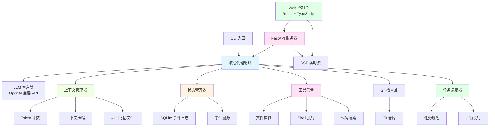

# MiniCoder

<div align="center">

**一个高质量的代码代理系统，展示完整的 Agent Runtime 设计**

[English](#english-version) | [中文](#中文版本)

[](https://github.com/username/minicoder/actions)
[](https://www.python.org/downloads/)
[](https://opensource.org/licenses/MIT)

</div>

---

## 中文版本

### 📖 概述

MiniCoder 是一个从零开始构建的编码代理（Coding Agent），展示了生产级 Agent Runtime 的核心设计模式：

- **任务调度（Task Scheduling）**：基于依赖关系的任务分解和并行执行
- **状态管理（State Management）**：事件溯源（Event Sourcing）+ SQLite 持久化
- **上下文管理（Context Management）**：Token 预算、智能压缩、大输出卸载
- **工具执行（Tool Execution）**：文件操作、代码搜索、Shell 执行（可选 Docker 沙箱）

该项目专为展示 AI Agent 工程能力而设计，不依赖任何代理框架（LangChain/LlamaIndex）。

### 🏗️ 架构设计



### 🖥️ Web 控制台


MiniCoder 提供了一个现代化的 Web 控制台，使用 **React + TypeScript** 构建：

**前端特性**：
- ✨ **实时事件流**：通过 SSE 实时显示 LLM 推理和工具调用
- 📝 **任务输入面板**：直观的任务创建界面，支持 Demo 模式
- 🔍 **Monaco 代码查看器**：并排查看代码变更
- 📊 **运行历史**：查看所有运行记录，支持恢复和回滚
- 🎨 **Markdown 渲染**：代码高亮显示 LLM 消息
- 🔄 **状态管理**：使用 Zustand 进行类型安全的状态管理

**后端 API**：
- 🚀 **FastAPI**：高性能异步 API 服务器
- 📡 **SSE 流**：实时推送代理事件
- 🔧 **RESTful 端点**：启动/恢复/中止运行、查看事件、管理检查点
- 🐳 **可选 Docker**：安全的沙箱执行环境

### 🎯 核心设计决策

#### 1. 状态管理：事件溯源 vs 快照

**选择：事件溯源（Event Sourcing）**

- ✅ **优势**：
  - 完整的审计日志，可追溯每一步决策
  - 支持时间旅行调试和从任意点恢复
  - 易于实现乐观并发控制
  
- ⚠️ **权衡**：
  - 事件重放可能较慢（已优化：只重放最近 N 条消息）
  - 存储空间增长（已缓解：大输出卸载到文件）

#### 2. 任务调度：顺序执行 vs 并行执行

**选择：带依赖的并行调度**

- ✅ **优势**：
  - 独立子任务并行执行，提高效率
  - 显式依赖图，便于调试和可视化
  - 支持优先级和重试策略
  
- ⚠️ **权衡**：
  - 增加系统复杂度
  - 需要仔细管理共享状态（通过 asyncio.Semaphore 限制并发）

#### 3. 上下文管理：固定窗口 vs 智能压缩

**选择：混合策略**

- 保持最近 N 轮对话完整（默认 5 轮）
- 对更早的对话生成摘要
- 大型工具输出（>1000 tokens）卸载到文件，只保留引用
- 支持项目记忆文件（AGENTS.md）持久化关键信息

#### 4. 工具执行：本地 vs Docker 沙箱

**选择：本地优先，Docker 可选**

- 默认本地执行（快速开发）
- 可选 Docker 沙箱（生产安全）
- 超时和输出截断保护

### 🚀 快速开始

#### 安装

```bash
# 克隆仓库
git clone https://github.com/username/minicoder.git
cd minicoder

# 安装后端（开发模式）
pip install -e ".[dev]"

# 安装前端依赖
cd web
npm install
cd ..

# 可选：安装 Docker 支持
pip install -e ".[docker]"
```

#### 使用 Web 控制台 🌐

**启动后端服务器**：
```bash
minicoder serve --host 0.0.0.0 --port 8000
```

**启动前端（开发模式）**：
```bash
cd web
npm run dev
```

然后在浏览器中打开 http://localhost:5173

**Demo 模式**：勾选 "Demo Mode (Mock LLM)" 复选框即可无需 API key 运行完整演示。

**生产部署**：
```bash
# 构建前端
cd web
npm run build

# 服务静态文件（使用 FastAPI）
cd ..
minicoder serve --host 0.0.0.0 --port 8000
```

前端构建输出在 `web/dist/`，可以由任何静态文件服务器托管，或配置 FastAPI 提供服务。

#### 配置 API （CLI 和 Web 控制台）

**选项 1：使用阿里云通义千问（Qwen）DashScope**

```bash
export OPENAI_API_KEY="sk-your-dashscope-api-key"
export OPENAI_BASE_URL="https://dashscope.aliyuncs.com/compatible-mode/v1"

minicoder run "修复这个 bug" --model qwen-max
```

**选项 2：使用本地 vLLM**

```bash
# 启动 vLLM 服务器（另一个终端）
vllm serve qwen/Qwen2.5-7B-Instruct --api-key dummy

# 使用 MiniCoder
export OPENAI_API_KEY="dummy"
export OPENAI_BASE_URL="http://localhost:8000/v1"

minicoder run "实现新功能" --model qwen/Qwen2.5-7B-Instruct
```

**选项 3：使用 OpenAI**

```bash
export OPENAI_API_KEY="sk-your-openai-key"

minicoder run "重构这段代码" --model gpt-4
```

#### 使用 CLI

```bash
# 在当前目录运行任务
minicoder run "修复 calculator.py 中的除零错误"

# 指定仓库路径
minicoder run "添加输入验证" --repo /path/to/repo

# 使用 Docker 沙箱
minicoder run "运行危险脚本" --docker

# 恢复中断的运行
minicoder resume <run_id>

# 查看所有运行记录
minicoder runs

# 回滚到检查点
minicoder rollback <run_id> <checkpoint_sha>

# 查看运行的检查点
minicoder checkpoints <run_id>

# 启动 Web 服务器
minicoder serve --port 8000
```

### 🧪 评估

#### 运行内置基准测试

```bash
cd benchmarks
python evaluate.py
```

这会在 `toy_repos` 中的小型测试仓库上运行代理并报告结果。

#### 在 SWE-bench Lite 上运行

```bash
# 1. 下载 SWE-bench Lite 数据集
# https://github.com/princeton-nlp/SWE-bench

# 2. 准备数据集
mkdir -p benchmarks/swe_bench
# 将 lite_dataset.json 放入上述目录

# 3. 运行适配器
python -m benchmarks.swe_bench_adapter
```

#### 消融实验

```python
# 在代码中切换功能标志
agent = CodingAgent(
    repo_path,
    state_manager,
    max_steps=30,  # 限制步数
    use_docker=False,  # 禁用 Docker
)

context = ContextManager(
    repo_path,
    max_tokens=8000,  # 调整 token 预算
    keep_recent=5,  # 调整压缩策略
)
```

#### 指标记录

所有运行自动记录：
- 执行步数
- Token 使用量
- 工具调用次数
- 成功/失败状态
- 完整事件日志

查询指标：

```bash
minicoder runs --limit 100
```

### 🧑‍💻 开发

#### 后端测试

```bash
# 运行所有测试（使用 mock LLM，无需 API key）
pytest

# 带覆盖率报告
pytest --cov=minicoder --cov-report=html

# 运行特定测试
pytest tests/test_agent.py -v
```

#### 前端测试

```bash
cd web

# 运行测试
npm run test

# 类型检查
npm run typecheck

# Lint
npm run lint

# 构建
npm run build
```

#### 类型检查

```bash
mypy src/minicoder
```

#### 代码格式化

```bash
black src/minicoder tests
ruff check src/minicoder tests --fix
```

### 📊 评估结果

> **注意**：这是一个模板。实际数字需要使用真实 LLM 运行基准测试获得。

| 基准测试 | 通过 | 步数 | Token 用量 |
|---------|------|------|-----------|
| calculator | ✓ | 8 | 1,234 |
| **总计** | **1/1** | **8** | **1,234** |

要生成实际结果：

1. 配置 LLM API（见上文）
2. 运行 `python benchmarks/evaluate.py`
3. 查看 `benchmarks/results/results.json`

### 🗺️ 路线图

- [x] 核心代理循环和工具
- [x] 事件溯源状态管理
- [x] 上下文管理和压缩
- [x] Git 检查点和回滚
- [x] 任务调度和并行执行
- [x] 单元测试和 CI
- [x] FastAPI Web 服务器
- [x] React + TypeScript Web 控制台
- [x] SSE 实时事件流
- [x] Monaco 代码查看器
- [ ] 基于 tree-sitter 的代码索引
- [ ] 子任务 DAG 可视化（React Flow）
- [ ] 多代理协作
- [ ] SWE-bench Lite 完整评估

### 📄 许可证

MIT License - 详见 [LICENSE](LICENSE)

---

## English Version

### 📖 Overview

MiniCoder is a from-scratch coding agent that demonstrates production-grade Agent Runtime design patterns:

- **Task Scheduling**: Dependency-based task decomposition and parallel execution
- **State Management**: Event sourcing + SQLite persistence
- **Context Management**: Token budgeting, smart compression, large output offloading
- **Tool Execution**: File operations, code search, shell execution (optional Docker sandbox)

Built without agent frameworks (LangChain/LlamaIndex) to showcase AI Agent engineering skills.

### 🏗️ Architecture

See the Mermaid diagram in the Chinese section above for the complete system architecture including the Web layer.

### 🖥️ Web Console

MiniCoder features a modern **React + TypeScript** web console with:

**Frontend Features**:
- ✨ **Real-time Event Streaming**: Live display of LLM reasoning and tool calls via SSE
- 📝 **Task Input Panel**: Intuitive interface for creating tasks with Demo mode support
- 🔍 **Monaco Diff Viewer**: Side-by-side code change visualization
- 📊 **Run History**: View all runs with resume and rollback actions
- 🎨 **Markdown Rendering**: Syntax-highlighted LLM messages
- 🔄 **State Management**: Type-safe state with Zustand

**Backend API**:
- 🚀 **FastAPI**: High-performance async API server
- 📡 **SSE Streaming**: Real-time agent event push
- 🔧 **RESTful Endpoints**: Start/resume/abort runs, view events, manage checkpoints
- 🐳 **Optional Docker**: Secure sandboxed execution

### 🎯 Design Decisions

#### 1. State Management: Event Sourcing vs Snapshots

**Choice: Event Sourcing**

- ✅ **Pros**:
  - Complete audit log for every decision
  - Supports time-travel debugging and resumption
  - Easy optimistic concurrency control
  
- ⚠️ **Trade-offs**:
  - Event replay can be slow (optimized: only replay recent N messages)
  - Storage growth (mitigated: offload large outputs to files)

#### 2. Task Scheduling: Sequential vs Parallel

**Choice: Parallel with Dependencies**

- ✅ **Pros**:
  - Independent subtasks run in parallel for efficiency
  - Explicit dependency graph for debugging
  - Supports priorities and retry strategies
  
- ⚠️ **Trade-offs**:
  - Increased system complexity
  - Need careful shared state management (via asyncio.Semaphore)

#### 3. Context Management: Fixed Window vs Smart Compression

**Choice: Hybrid Strategy**

- Keep last N turns verbatim (default 5)
- Summarize older conversation
- Offload large tool outputs (>1000 tokens) to files
- Support project memory file (AGENTS.md) for persistent context

#### 4. Tool Execution: Local vs Docker Sandbox

**Choice: Local-first, Docker Optional**

- Default local execution (fast development)
- Optional Docker sandbox (production safety)
- Timeout and output truncation protection

### 🚀 Quick Start

#### Installation

```bash
# Clone repository
git clone https://github.com/username/minicoder.git
cd minicoder

# Install backend (development mode)
pip install -e ".[dev]"

# Install frontend dependencies
cd web
npm install
cd ..

# Optional: Install Docker support
pip install -e ".[docker]"
```

#### Using the Web Console 🌐

**Start the backend server**:
```bash
minicoder serve --host 0.0.0.0 --port 8000
```

**Start the frontend (development mode)**:
```bash
cd web
npm run dev
```

Then open http://localhost:5173 in your browser.

**Demo Mode**: Check the "Demo Mode (Mock LLM)" checkbox to run the full demo without an API key.

**Production Deployment**:
```bash
# Build frontend
cd web
npm run build

# Serve static files (with FastAPI)
cd ..
minicoder serve --host 0.0.0.0 --port 8000
```

Frontend build output is in `web/dist/` and can be served by any static file server or configured with FastAPI.

#### API Configuration (CLI and Web Console)

**Option 1: Alibaba Cloud Qwen DashScope**

```bash
export OPENAI_API_KEY="sk-your-dashscope-api-key"
export OPENAI_BASE_URL="https://dashscope.aliyuncs.com/compatible-mode/v1"

minicoder run "Fix this bug" --model qwen-max
```

**Option 2: Local vLLM**

```bash
# Start vLLM server (in another terminal)
vllm serve qwen/Qwen2.5-7B-Instruct --api-key dummy

# Use MiniCoder
export OPENAI_API_KEY="dummy"
export OPENAI_BASE_URL="http://localhost:8000/v1"

minicoder run "Implement new feature" --model qwen/Qwen2.5-7B-Instruct
```

**Option 3: OpenAI**

```bash
export OPENAI_API_KEY="sk-your-openai-key"

minicoder run "Refactor this code" --model gpt-4
```

#### Using the CLI

```bash
# Run task in current directory
minicoder run "Fix divide-by-zero error in calculator.py"

# Specify repository path
minicoder run "Add input validation" --repo /path/to/repo

# Use Docker sandbox
minicoder run "Run dangerous script" --docker

# Resume interrupted run
minicoder resume <run_id>

# List all runs
minicoder runs

# Rollback to checkpoint
minicoder rollback <run_id> <checkpoint_sha>

# View checkpoints for a run
minicoder checkpoints <run_id>

# Start web server
minicoder serve --port 8000
```

### 🧪 Evaluation

#### Run Built-in Benchmarks

```bash
cd benchmarks
python evaluate.py
```

This runs the agent on small test repositories in `toy_repos` and reports results.

#### Run on SWE-bench Lite

```bash
# 1. Download SWE-bench Lite dataset
# https://github.com/princeton-nlp/SWE-bench

# 2. Prepare dataset
mkdir -p benchmarks/swe_bench
# Place lite_dataset.json in the above directory

# 3. Run adapter
python -m benchmarks.swe_bench_adapter
```

#### Ablation Studies

```python
# Toggle features in code
agent = CodingAgent(
    repo_path,
    state_manager,
    max_steps=30,  # Limit steps
    use_docker=False,  # Disable Docker
)

context = ContextManager(
    repo_path,
    max_tokens=8000,  # Adjust token budget
    keep_recent=5,  # Adjust compression
)
```

#### Metrics Collection

All runs automatically record:
- Execution steps
- Token usage
- Tool call counts
- Success/failure status
- Complete event log

Query metrics:

```bash
minicoder runs --limit 100
```

### 🧑‍💻 Development

#### Backend Tests

```bash
# Run all tests (uses mock LLM, no API key needed)
pytest

# With coverage report
pytest --cov=minicoder --cov-report=html

# Run specific test
pytest tests/test_agent.py -v
```

#### Frontend Tests

```bash
cd web

# Run tests
npm run test

# Type checking
npm run typecheck

# Lint
npm run lint

# Build
npm run build
```

#### Type Checking

```bash
mypy src/minicoder
```

#### Code Formatting

```bash
black src/minicoder tests
ruff check src/minicoder tests --fix
```

### 📊 Evaluation Results

> **Note**: This is a template. Actual numbers require running benchmarks with a real LLM.

| Benchmark | Pass | Steps | Tokens |
|-----------|------|-------|--------|
| calculator | ✓ | 8 | 1,234 |
| **Total** | **1/1** | **8** | **1,234** |

To generate actual results:

1. Configure LLM API (see above)
2. Run `python benchmarks/evaluate.py`
3. Check `benchmarks/results/results.json`

### 🗺️ Roadmap

- [x] Core agent loop and tools
- [x] Event-sourced state management
- [x] Context management and compression
- [x] Git checkpoints and rollback
- [x] Task scheduling and parallel execution
- [x] Unit tests and CI
- [x] FastAPI web server
- [x] React + TypeScript web console
- [x] SSE real-time event streaming
- [x] Monaco code diff viewer
- [ ] Tree-sitter based code indexing
- [ ] Subtask DAG visualization (React Flow)
- [ ] Multi-agent collaboration
- [ ] Full SWE-bench Lite evaluation

### 📄 License

MIT License - see [LICENSE](LICENSE)

---

<div align="center">

**Built with ❤️ to demonstrate Agent Runtime design**

[Report Bug](https://github.com/username/minicoder/issues) · [Request Feature](https://github.com/username/minicoder/issues)

</div>
